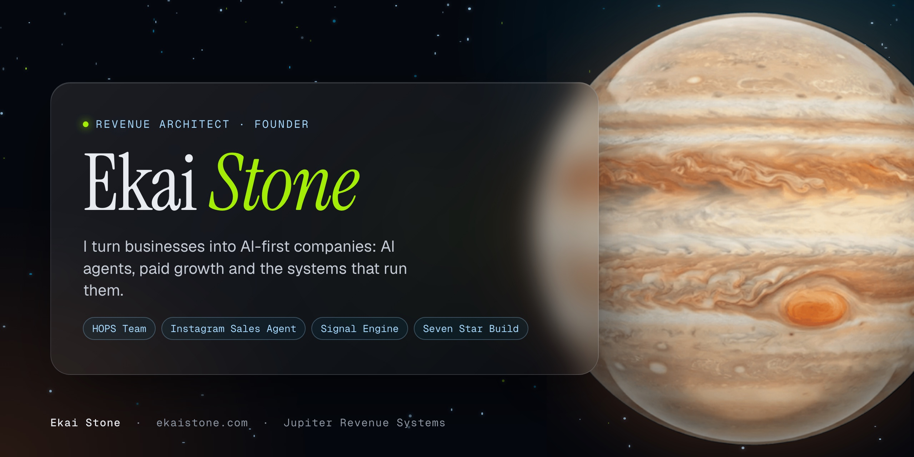

### Revenue architect. Founder, Jupiter Revenue Systems.

Meta ads since 2012. Working for myself since 19. I build revenue systems: the offer, pages, checkout, email, tracking, Meta ads, CRM and the inbox agent that books calls. AI agents do the building.

  
  
  
  
  

| 17 years | $400M+ | 8.3x | 1.2 yrs |
|:---:|:---:|:---:|:---:|
| operating | revenue generated | average ROAS | average client retention |

The $400M+ includes work before online coaching: automotive groups, real estate brokerages, a legal services firm and local businesses, 2009 to 2020.

---

## The HOPS Team · 6 plug-in AI agents · $37

Install these 6 AI agents tonight and they'll run your content, support and ads the way you would, so you hit $10K a month hands-off, without hiring a team. Paste one line into Claude and they go to work. **[Meet your HOPS Team →](https://github.com/jupiter-revenue-systems/hops-team)**

| | Agent | What it does |
|---|---|---|
| 01 | **One Memory For Every Agent** | Remembers your offers, voice and rules. |
| 02 | **Content That Makes Itself** | Turns raw clips into posts in your brand. |
| 03 | **Blog Posts That Bring Buyers** | Writes long-form posts that sell. |
| 04 | **Your Site, Built By Claude** | Builds and updates your site for you. |
| 05 | **Support That Runs Itself** | Answers your customers in minutes. |
| 06 | **Claude Runs Your Meta Ads** | Builds and reports on your ads. |
| + | **Your Hands-Off Profit Map** | Where AI can take over your delivery, ranked by hours given back. |

**AI add-ons:** The Feedback Loop Skill ($37) · Senior Media Buyer Brains ($49) · IG Sales Agent · Starter ($27) · Full HOPS Team, all three ($77)

## Products and engines

| | | |
|---|---|---|
| **[The HOPS Team](https://github.com/jupiter-revenue-systems/hops-team)** | 6 plug-in AI agents that run your content, blog, site, support and ads in your voice. Works with Claude. | **$37** · [Get it](https://ekaistone.com/hops) |
| **[Instagram Sales Agent](https://github.com/jupiter-revenue-systems/instagram-sales-agent)** | Your own AI sales agent in your Instagram DMs. It answers, qualifies and books in your voice, and you give it a name. Runs on ARIA. | **From $27** · [Get it](https://ekaistone.com/ig-sales-agent) |
| **[Signal Engine](https://github.com/jupiter-revenue-systems/signal-engine)** | Pixel plus Conversions API with shared event IDs, so Meta counts every sale once. Ships inside every Seven Star Build. | **Licensed** · [Apply](https://ekaistone.com/seven-star/apply) |
| **[The Seven Star Build](https://github.com/jupiter-revenue-systems/seven-star-build)** | Turn your business into an AI-first company, on accounts you own. For telehealth clinics, coaches, consultants, creators and agency owners. Live in 7 days. | **From $15,000** · [See the Build](https://ekaistone.com/seven-star/build) |

> **ARIA and the Signal Engine are proprietary Jupiter Revenue Systems engines.** They're licensed inside every build, never published as source. Paid repositories are private to buyers; each one has a public page here with everything it does and how to get access.

## Built with

---

Ekai Stone · Revenue architect · <a href="https://ekaistone.com">ekaistone.com</a> · Jupiter Revenue Systems · Los Angeles

